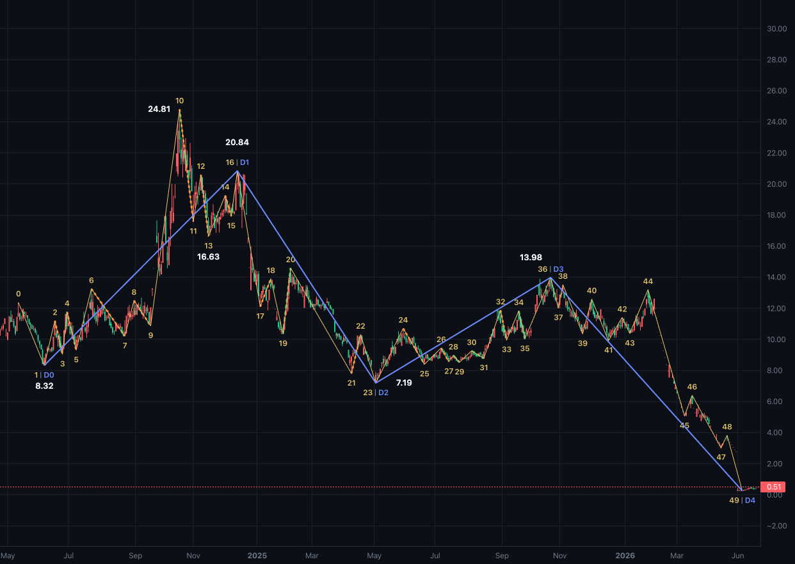
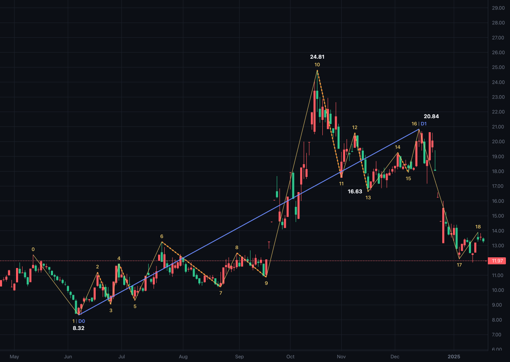
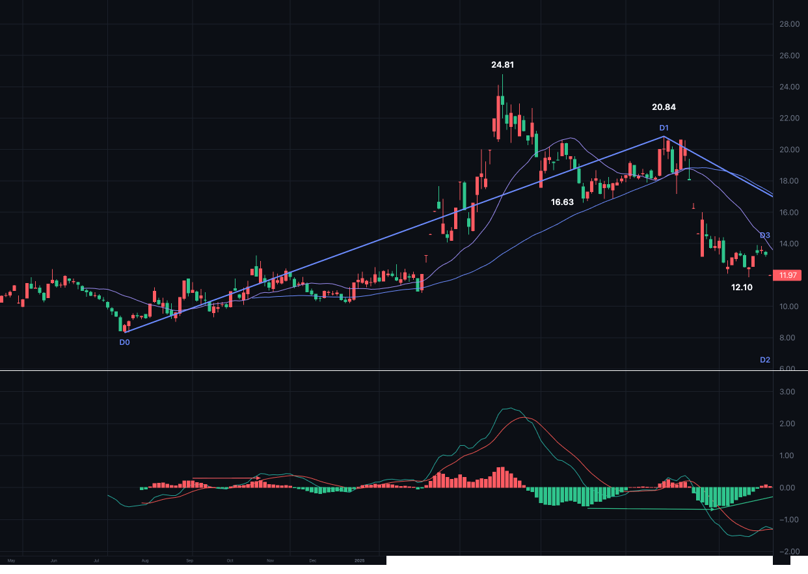

# 缠论-线段

> 笔描述的是最小的上下摆动，段描述的是这些摆动组成的更大一级走势。
> 本文只谈缠论里的线段：它由什么构成、特征序列如何确认一段的结束，以及一段主升主跌里的回抽该怎么处理。

---

## 一、什么是线段

缠论的技术分析体系里，价格结构通常按「K 线 → 笔 → 段 → 中枢 → 走势」逐级组织。笔是最小的一层：一个底分型到一个顶分型（或反过来）之间的摆动，至少由 6 根去包含后的 K 线构成。段是笔的上一层：由至少 3 笔组成，方向由第一笔决定，相邻两段共享端点、方向交替。

和笔相比，段做的事情是**过滤**。一笔可能只持续几天，里面包含很多噪声；段把一组相邻的笔连起来，只要中间的来回没有真正破坏这轮走势，就用一段来描述一轮更大的上涨或下跌。

段的用途主要有两个。第一，它是段中枢的输入：至少 3 段的重叠区间才构成一个段中枢。第二，它提供了一个更粗的结构视角：笔的级别看的是几天到几周的摆动，段的级别看的是几个月的主升、主跌和整理。

*图一：000004 日线全图（2024-04-24 至 2026-06-26，500 根 K 线）。黄色细线是笔，黄色文字是笔的序号；蓝色粗线是线段；橙色和绿色虚线是特征序列，沿对应的笔线绘制、画在笔线之上：橙色是未参与合并的原始元素，绿色是包含合并后保留的元素；每个段只画本段的特征元素，所以同一段里两种颜色可以同时出现。这张图里有 49 笔、4 段。图上用价格标签标出了 8.32、24.81、16.63、20.84、7.19、13.98 这些关键价位。图上的 D 是**端点编号**：D0 是第 1 段的起点（8.32），D1–D4 是四段的终点，D0→D1 就是第 1 段，D 后面的数字不是段号。黄色文字是笔的序号，蓝色文字是段的端点，颜色分别和笔线、段线一致；两者落在同一点时并排显示，中间用细竖线隔开（例如 16 │ D1），不再使用圆点或方块图标。*

需要先说明一点：**段不是唯一的**。同样的 K 线，换一个时间周期、换一段历史窗口，或者对「回抽多大算破坏趋势」取不同的标准，画出来的段就会不同。下面这套口径只是缠论里的一种分段方法，不是唯一的画法。

---

## 二、线段由什么组成

段的原材料是笔，笔的原材料是分型，分型的原材料是去包含后的 K 线。这三层任何一层变了，段都会跟着变。

### 2.1 去包含与分型

K 线先做包含关系处理。相邻两根 K 线如果一根完全包住另一根，就合并成一根：向上处理时取更高的高点和更高的低点，向下处理时取更低的高点和更低的低点，时间取极值所在的那根 K 线。合并方向由前两根 K 线的高点比较决定。

合并之后，连续 3 根 K 线可以构成分型。顶分型要求中间那根的高点高于左右两根，低点也高于左右两根；底分型的要求反过来。分型列表强制顶底交替，避免连续出现两个同向分型。

### 2.2 笔

笔从一个分型出发，去找反方向的极值分型。比如底分型作为起点，就找它之后、价格更高的顶分型里高点最高的那一个。起点分型和终点分型之间不能有包含关系，并且从起点分型的第一根 K 线到终点分型的第三根 K 线，至少要有 6 根去包含后的 K 线。

笔的最小长度取 6 根去包含 K 线，是笔的常见口径之一。这个数字不是缠论里唯一的标准，取 5 根或更长的口径也有人用；数字变了，笔和段都会跟着变。

### 2.3 特征序列

段的核心概念是**特征序列**。

- 向上段的特征序列，是段内所有**向下笔**。每个元素取这笔的（顶，底），也就是（起点价，终点价）。
- 向下段的特征序列，是段内所有**向上笔**。每个元素取这笔的（底，顶），也就是（起点价，终点价）。

为什么取反向笔？因为一段上涨里，真正决定它有没有结束的，是每次回抽的结构：回抽的低点是不是在抬高，回抽之后能不能再创新高。反向笔正好把这些回抽单独列了出来。

特征序列也要做包含合并，合并方向和段方向相反：

- 向上段：顶和底都取较小的那个；
- 向下段：底和顶都取较大的那个。

画图时只取本段范围内的特征元素：确认分型时可能已经看到段末之后的笔，那些笔归入后续段，不算本段的特征序列。未参与合并的特征元素用橙色，包含合并后保留的元素用绿色；同一段里两种颜色可以同时出现，它们仍然是同一条特征序列。

合并之后，如果向上段的特征序列出现顶分型（中间元素的高点和低点都最高），这段上涨就结束了；向下段出现底分型（中间元素的高点和低点都最低），这段下跌就结束了。

段的终点，在这根反向笔之前（不含它）的段内同向笔中，取终点价最优的一笔。这里有一个容易忽略的细节：**这个极值笔可能比分型确认的位置更早**。从极值笔的下一笔开始，后面的笔都归入下一段，包括参与这次分型确认的那几笔。这样段与段之间共享端点，不会出现一段的终点落在另一段内部的情况。

---

## 三、怎么算：两个阶段

划分分两步：先按特征序列画出基础线段，再把浅回抽合并成走势段。

### 3.1 第一阶段：基础线段

1. 从某一笔开始，段方向取这一笔的方向，段至少要有 3 笔。
2. 从它的下一笔开始，把与段方向相反的笔依次加入特征序列，每加入一个就做一次包含合并。
3. 合并后的序列至少有 3 个元素时，检查最后 3 个元素：向上段看顶分型，向下段看底分型。
4. 出现分型，段就结束。段终点在分型中间元素对应的反向笔之前（不含这根反向笔）的段内同向笔中，取终点价最优的一笔（向上取最高，向下取最低；相同极值取靠后的一笔）。
5. 下一段从极值笔的下一笔开始，方向自然相反。
6. 如果一直走到最后一笔都没有出现分型，最后这一段就是未完成段。

这一步只关心特征序列，不考虑「回抽大不大」。

### 3.2 第二阶段：回抽合并

只用第一阶段，图上的段会偏碎。一条主升浪里的一次正常回抽，也会被切成一条独立的向下段，读起来像趋势断了好几次。

所以第二阶段把满足以下四个条件的反向线段当作**回抽**，合并进趋势段：

1. **没有破坏趋势段的起点**。向上段要求回抽的最低点不低于趋势段的起点价；向下段要求回抽的最高点不高于趋势段的起点价。
2. **回抽幅度不到趋势幅度的一半**。幅度按「终点价相对起点价的涨跌幅绝对值」计算；回抽幅度乘 2 仍小于趋势段自身的幅度，才算浅回抽。
3. **后面那条同向线段仍然有效**，也就是它的终点沿着自己的方向超越了起点。
4. **参与判断的三条基础线段（趋势段、回抽段、后面那段）都没有被合并过**。每条段最多吸收一次回抽，避免把多段回抽链式吞并成一条巨大的段。

四条都满足时，合并成一条走势段：起点取趋势段的起点，终点取后面那条同向段的终点，方向取趋势段的方向。段内最高价和最低价仍然记录整段的真实区间，特征序列取趋势段和后一段的并集，中间的回抽段不算。

此外，不足 3 笔或者方向无效的基础线段会被清理，分三种情况：
1. 它前面有段、后面也有段，而且前后两段同向：说明它只是夹在两条同向段之间的一次回抽，把它和前后两段合成一条，终点取后一段的终点；
2. 否则，如果它前面有段：把它并入前一段，前一段的终点延伸到它的终点；
3. 如果它是行情开篇的第一个基础线段（前面没有段）：直接跳过，不把后一段的起点拉回到它的起点。

### 3.3 口径与结果

| 项目 | 本文口径 |
| --- | --- |
| 笔的最小长度 | 6 根去包含 K 线 |
| 段的最小笔数 | 3 笔 |
| 特征序列合并 | 向上段取小、向下段取大 |
| 段终点 | 段内同向笔的极值笔，可能早于分型确认的位置 |
| 回抽幅度 | 小于趋势幅度的一半 |
| 回抽破坏起点 | 向上段看低点、向下段看高点 |
| 每条段合并次数 | 最多 1 次回抽 |
| 未完成段 | 延伸到最后 1 笔，等待分型确认 |

一条段至少要能回答四个问题：方向、起止端点、由哪些笔组成，以及特征序列是否已经确认结束。段的端点不一定是段内极值，这一点在 000004 的例子会看到。

---

## 四、000004 日线：四段是怎么来的

000004 日线在 2024-04 到 2026-06 的 500 根 K 线里，先得到 49 笔，再得到 4 段：

| 段 | 方向 | 端点编号 | 起点 | 终点 | 备注 |
| --- | --- | --- | --- | --- | --- |
| 1 | 向上 | 1–16 | 2024-06-07，8.32 | 2024-12-13，20.84 | 段内最高 24.81、最低 8.32 |
| 2 | 向下 | 16–23 | 2024-12-13，20.84 | 2025-05-07，7.19 | 与段 1 共享 20.84 这个端点 |
| 3 | 向上 | 23–36 | 2025-05-07，7.19 | 2025-10-24，13.98 | 与段 2 共享 7.19 这个端点 |
| 4 | 向下 | 36–49 | 2025-10-24，13.98 | 2026-06-26，0.25 | 未完成，等待底分型确认 |

表里的数字是**端点编号**（从 0 开始：端点 0 是 12.38，端点 1 是 8.32，端点 16 是 20.84）。第 k 笔的终点就是端点 k，所以图上黄色文字的编号和表里的端点编号能对上。端点 1 是第 1 笔的终点，也是第 2 笔的起点；端点 0→1 这一笔只有 1 笔，构不成段，被跳过，所以段 1 从端点 1 开始。段与段共享端点，所以段 2 从端点 16 开始，写成 16–23。图上的 D0 就是端点 1，D1–D4 是四段的终点。

### 4.1 段 1 为什么结束在 20.84，而不是 24.81

这是这段行情里最容易被问到的点。

只看第一阶段，段 1 附近的基础线段的顺序是这样的：

- 端点 1→10 向上，8.32 → 24.81；
- 端点 10→13 向下，24.81 → 16.63；
- 端点 13→16 向上，16.63 → 20.84。

端点 0→1（12.38 → 8.32）是开篇向下的那一笔，只有 1 笔，构不成段，所以被跳过；向上的段 1 从端点 1（8.32）开始。

按特征序列，端点 1→10 这条向上的基础线段在 24.81 之后已经出现过一次顶分型，先结束了。但第二阶段检查端点 10→13 这条回抽：

- 回抽低点 16.63，高于段 1 的起点 8.32，没有破坏趋势起点；
- 回抽幅度约 33%，上涨段从 8.32 到 24.81 的幅度约 198%，33% 不到 198% 的一半；
- 端点 13→16 的终点 20.84 高于 16.63，后一条同向线段有效。

这些条件都满足，端点 10→13 被视为回抽，和端点 1→10、端点 13→16 合并。合并后的段 1 终点取端点 16，也就是 20.84。24.81 没有被丢掉，它仍然是这条段里的最高价，只是段线的端点画在 20.84。

**段的终点回答的是「这段趋势最后走到哪里」，段内最高价回答的是「这段区间里最高到过哪里」**。在回抽之后又创出更低的高点时，这两个值就会分开。

*图二：段 1 的局部（2024-04-24 至 2025-01-20）。蓝色段线只画段 1，从 D0（8.32）到 D1（20.84）；端点 0→1 的开篇下跌（12.38→8.32）在 D0 左侧，不属于段 1。黄色笔线和编号一直画到图右端；端点 10 的高点是 24.81，端点 13 的低点是 16.63。图上用价格标签标出了 8.32、24.81、16.63、20.84 这四个价位。橙色虚线是段 1 的特征序列，沿对应的笔线绘制；段 1 的特征元素都在段内，没有出现包含合并后保留的绿色元素。*

### 4.2 段 2 与段 3

段 2 从 20.84 向下走到 7.19，基础线段是端点 16→23。段 2 的低点 7.19 跌破了段 1 的起点 8.32，破坏了趋势起点，所以它不能被当作段 1 的回抽合并进去，保留为一条独立的向下段。

段 3 从 7.19 向上走到 13.98，基础线段是端点 23→36。它后面那条向下的基础线段（端点 36→41）本身幅度不大，但再后面的向上基础线段（端点 41→49）方向无效，不满足「后面同向段仍然有效」这一条，所以端点 36→41 没有被当作段 3 的回抽合并进去，段 3 结束在 13.98。

### 4.3 段 4 为什么是「未完成」

段 4 的基础部分是端点 36→41，向下到 9.91。后面端点 41→49 是一段向上的基础线段，但它的终点 0.25 低于起点 9.91，方向无效。这段无效线段被并入前面的向下段（端点 36→41），段 4 于是延伸成端点 36→49，向下到 0.25。由于走完所有笔都没有出现底分型，段 4 仍未完成。新的 K 线进来之后，这段还会继续变化。

### 4.4 两种终结背后的资金博弈

前面说过，段有两种结束方式。一种是**特征序列出现分型**：向上的段走出顶分型，向下的段走出底分型，基础线段结束。另一种是**反向线段真正破坏趋势**：回抽跌破或升破趋势起点，或者回抽足够深，后面的同向段也不再有效，走势段结束。前者是结构层的第一次警告，后者是趋势层的防线失守。两者的资金含义并不一样。

| 终结方式 | 看到的信号 | 资金含义 | 容易误读成 |
| --- | --- | --- | --- |
| 特征序列分型 | 顶/底分型、包含合并 | 一方最后一次推进失败，局部供需第一次失衡 | 趋势已经反转 |
| 反向线段终结 | 回抽破起点、幅度过半、后段无效 | 关键防线失守，获利盘和止损盘集中，资金结构改变 | 只是一次洗盘 |

先看分型终结。特征序列的分型，是同一批资金在相近价位反复尝试后的结果。向上段的顶分型，中间那根反向笔的高点，是多方最后一次把价格推上去的位置；第三根反向笔没能再创新高，说明这次推进没有足够的跟随资金。它不一定意味着趋势立刻反转，更多时候只是「买方开始犹豫」的第一个证据。包含合并也是同一个道理：两根反向笔互相包含，说明多空在同一个区间里来回换手，谁也没有把价格带出这个区间；重叠越久，后面选择方向时需要的资金就越多。

再看反向线段终结。回抽不破趋势起点、幅度不到趋势的一半，说明前面的获利盘没有恐慌性兑现，新的买盘（向上段）或卖盘（向下段）还在原来的方向上承接。这种回抽更像换手：老资金把筹码交给新资金，价格退一步，但没有退到趋势的防线后面。反过来，回抽跌破趋势起点，或者幅度超过趋势的一半，说明防守方已经守不住关键价位：获利盘开始集中兑现，止损盘被触发，原本观望的资金也站到了反向一边。这时候趋势结束，不是因为价格涨不动了，而是原来的资金结构被打散了。

放回 000004 的段 1 看，会更清楚。24.81 是这轮上涨的情绪高点，价格在那里加速，愿意在更高价格接货的边际买盘把价格推到了极端；随后价格回抽到 16.63，又只反弹到 20.84，没有创新高。20.84 是多方再次尝试推高时没有得到资金确认的位置，也是段 1 实际结束的位置。回头看，后面的下跌跌破了 16.63，说明这次推高没有守住，段 1 的结束得到确认。所以段 1 的终点不是 24.81，而是 20.84：24.81 是情绪的高点，20.84 是资金不再愿意为新高买单的位置。段 2 的 7.19 则相反，那是下跌趋势里卖盘最后集中释放的位置；后面的反弹虽然回到 13.98，但没有再创新低，卖盘的力量已经用尽，段 2 在 7.19 结束。

两种终结的关系可以概括为：**分型告诉你「这里可能有人开始撤了」，反向线段告诉你「撤的人已经足够多，原来的防线守不住了」。** 前者是局部供需的第一次失衡，后者是趋势级别资金结构的改变。两阶段分段先找分型，再用回抽的深度和是否破起点去过滤，其实是在问：这次反向运动，是一次换手，还是一次资金结构的改变？

需要说明的是，以上是从价格行为解释资金博弈，不是量能指标，也不构成买卖信号。成交量、盘口和资金流向是更直接的证据；前面的图只画价格结构，没有把量能叠上去，4.5 再把均线、MACD、成交量和筹码单独拿出来对照。真实市场里，同样的分型可能只是整理，同样的深回抽也可能是一次假突破；结构给出的是「哪里发生了变化」，不是「变化之后一定怎么走」。

### 4.5 指标间交叉验证

把 000004 段 1 前后的行情拆开，几个指标给出的信号并不整齐。

先看均线和 MACD（图三）。24.81 那天收 22.88，DIF 2.45，DEA 1.81，红柱 0.64；到 20.84 那天收 20.05，DIF 0.18，红柱 0.19。顶背驰要看零轴上方的红柱：24.81 的红柱 0.64，20.84 只剩 0.19，动能确实弱了很多。20.84 那根红柱很矮，图上几乎贴着零轴，视觉上容易被后面的绿柱抢走注意力。不过严格说，这不是标准的顶背驰。标准顶背驰要求价格创新高、MACD 不创新高；20.84 本身是一个更低的高点，所以这里只能叫反弹动能减弱。零轴下方的绿柱是 20.84 之后 DIF 下穿 DEA 才出现的，它确认的是动能转负，不是顶背驰本身。

均线慢得多：20.84 时 MA20 和 MA60 都在 18.20 附近，收盘 20.05 还在两条均线之上，均线当时没有给出卖点。16.63 那天的收盘 16.89 已经跌破 MA20 的 20.15，但仍在 MA60 的 16.06 上方，所以那次回抽在均线上只是跌破短期均线，没有跌破中期均线。真正跌到两条均线下方要等到 2025-01-06，那天收 12.52，MA20 16.96，MA60 18.58。均线在这里没有提前报警，它把 20.84 之后的下跌确认成趋势级别的破位，时间上比 MACD 和筹码晚。

*图三：000004 日线 2024-04-24 至 2025-01-20。蓝色粗线是段 1，从 D0（8.32）到 D1（20.84）；紫色细线是 MA20，蓝色细线是 MA60，下方是 MACD。24.81、16.63、20.84、12.10 四个价位用文字标出，图上没有画特征序列。*

再看成交量和筹码（图四）。24.81 当天成交 3915 万股，前五日均量 3188 万股；20.84 当天成交 3510 万股，前五日均量只有 1503 万股。单日量看上去差不多，均量却差了一半，所以「20.84 是缩量反弹」只说对了一半：反弹那几天整体是缩量的，但 20.84 当天有一根放量。这个信号本身是矛盾的，不能把它当成干净的缩量背离。2025-01-06 跌到 12.10 时，成交量 848 万股，前五日均量 970 万股，是一根缩量阴线。缩量下跌说明抛压不重，也可能是买盘不足，单看量能分不出是哪一种；段 1 结束后的这段下跌，在量能上一直没有得到干脆的确认。

筹码的读数更直接。20.84 当天，主筹码峰在 20.06，70% 成本区间是 18.00–20.27，获利盘 66.6%。价格从 24.81 跌到 16.63 再反弹到 20.84，主峰从 23.16 下移到 20.06，24.81 附近的追高筹码已经在 20 元一带堆成新的峰。20.84 的反弹高点只比 70% 成本上沿 20.27 高一点点，收盘 20.05 又回到区间里，没有继续向上打开空间。随后 2025-01-06 跌到 12.10，主峰降到 14.28，获利盘只剩 3.6%，70% 成本区间变成 13.67–19.86。原来 18–20 元一带的筹码几乎全部转为套牢，这比均线更早、也更清楚地说明了 20.84 之后发生了什么。

*图四：同一个窗口，蓝色粗线仍是段 1；右侧的横向分布是 2025-01-06 的筹码分布，下方是成交量。24.81、16.63、20.84、12.10 四个价位用文字标出，图上没有画特征序列。*

图三和图四放在一起看，结论并不完全一致。MACD 和筹码对 20.84 的判断比较接近：价格没有创新高，MACD 的动能已经下来；筹码峰也从 23.16 移到 20.06，追高筹码在 20 元附近重新堆积。这两个信号都没有直接说「马上跌」，但都说明 24.81 那波追高的资金没有继续把价格往上推。均线同意这个方向，时间上却晚了二十多天。成交量只给出一半的证据，20.84 当天放量、反弹整体缩量、跌到 12.10 时又缩量，几个读数互相打架。四个指标没有同时确认段 1 结束：价格结构和筹码先转向，MACD 同步，均线滞后，量能含糊。

几个指标不一致时，至少能看出哪一部分证据是硬的。段 1 在 20.84 结束，筹码和 MACD 支持得比较充分，均线是事后确认，量能没有给出干净的结论。

---

## 五、线段与段中枢

段画出来之后，从某一段开始，连续 3 段的重叠区间可以构成一个**段中枢**：上沿取这 3 段高点的最小值，下沿取这 3 段低点的最大值。后面的段只要与这个区间相交，就继续纳入这个中枢（上沿、下沿不变），直到某一段完全离开区间。

000004 的 4 段只形成一个段中枢。四段的区间分别是：

- 段 1：8.32–24.81；
- 段 2：7.19–20.84；
- 段 3：7.19–13.98；
- 段 4：0.25–13.98。

段 1 到段 3 先定出区间，段 4 仍然与它相交，所以也被纳入。四段共同覆盖的区间是 `[max(8.32, 7.19, 7.19, 0.25), min(24.81, 20.84, 13.98, 13.98)]`，也就是 `[8.32, 13.98]`。因为段的数量少、每段跨度大，这个段中枢会覆盖很长一段时间，看起来像一个很宽的盒子。它是段级别的结构参考，不是精确的支撑位或压力位。

*图五：000004 日线的段级别中枢。蓝色线是四段，紫色矩形是段中枢 `[8.32, 13.98]`。这张图只保留段与段中枢，没有画特征序列。*

笔中枢和段中枢是两个级别：笔中枢由 3 笔重叠构成，数量通常更多、区间更窄；段中枢由 3 段重叠构成，数量少、区间宽。两者回答的是不同级别的问题，不能互相替代。

---

## 六、局限性

**段依赖级别和窗口。** 同一只股票，日线和 60 分钟画出来的段不一样；500 根 K 线和 200 根 K 线也可能不一样。段是局部结构，窗口一变，端点就可能跟着变。

**两阶段办法是一种近似。** 第一阶段按特征序列分型法；第二阶段用「不破起点、幅度不到一半、后段有效」三个实质条件判断回抽，并限制每条段最多吸收一次。缠论原著对特征序列的缺口、第二种情况还有更细的讨论，这里没有全部展开；回抽幅度阈值和「每条段最多吸收一次」都是实际划分时的取舍。换一套标准或换一种画法，段的数量和端点都可能不同。

**段端点不一定是段内极值。** 回抽合并之后，段 1 的端点是 20.84，而段内最高点是 24.81。读图时要把「段线画到哪里」和「这段里最高/最低到过哪里」分开看。

**未完成段会变。** 最后一段没有分型确认，随着新 K 线出现，它的终点和方向都可能改变。把未完成段当成已经确定的转折，是常见的误读。

**段中枢在段很少时很粗。** 000004 只有一个 `[8.32, 13.98]` 的段中枢，跨了两年多。段的数量越少，段中枢越像一个大区间，越不适合拿来做精确的买卖点判断。

---

## 七、风险提示

本文讲的是线段的结构和一种分段口径，不构成投资建议。缠论是一种结构化的读图方法，它不预测价格，也不保证任何形态之后一定上涨或下跌。任何技术分析都可能失效，实际决策需要结合仓位、止损和自身的风险承受能力。
