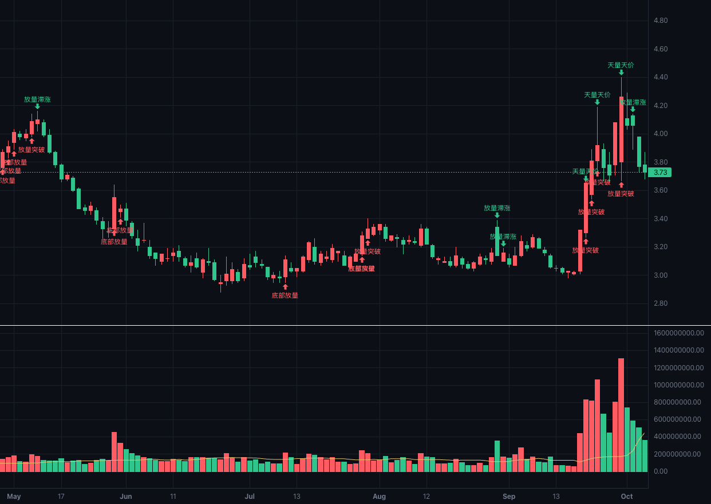
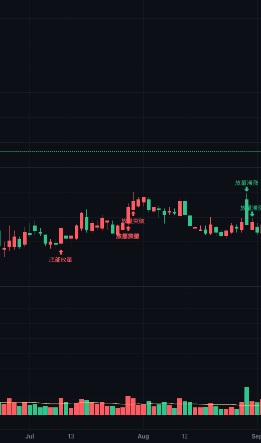
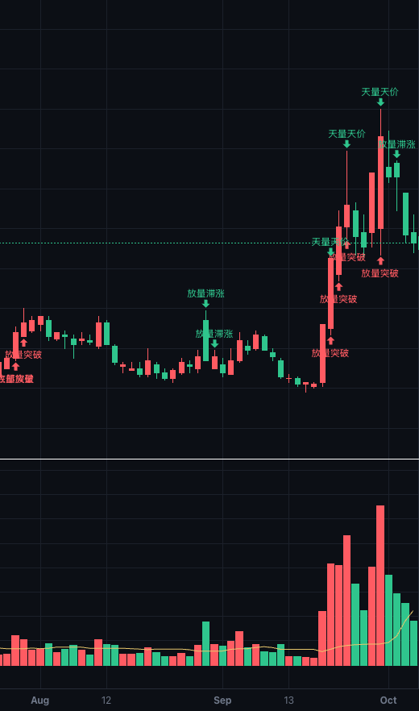

# 量价：把"放量"和"缩量"变成可执行的条件

> **一句话**：成交量指标告诉你"今天的量大不大"，量价指标告诉你"量大之后价格跟没跟"——
> 后者才是买卖判断真正依赖的东西。它把 7 种经典量价关系写成 7 个可判定的条件，
> 可以进策略、可以被回测。

---

## 一、为什么会有这个指标

打开任何一张 K 线图，成交量永远在下方那个副图里。它能告诉你很多事：今天是倍量还是缩量、
量能创新高还是创新低、是梯量递增还是连续萎缩。但它只描述**量自己**。

真正决定判断的是量和价的关系。同样叫"放量"：

- 放量之后价格**突破**了前期高点 → 通常读作需求接管；
- 放量之后价格**没动**（甚至滞涨）→ 通常读作供给在派发。

这两个形态的量能表现几乎一样，含义却相反。传统上这类判断靠"看图经验"完成——盯盘的人
看一眼就知道是前者还是后者，但这件事**没法写进策略**，因为它没有可判定的定义。

量价指标做的事，就是把这批"看图经验"翻译成精确的条件判定：每一根 K 线，逐条问它
"你的量相对基线是多少""你的价有没有越过前高""这两件事同时成立吗"。成立就标记出来，
不成立就什么都不说。

---

## 二、指标由什么组成

| 组成 | 内容 |
| --- | --- |
| **副图（量能）** | 成交量柱（按当日阴阳着色）+ 一条**量能基线**折线 |
| **主图（标记）** | 4 个买卖箭头，落在对应的 K 线上 |
| **7 个形态（事件）** | 放量突破、缩量回调、量价齐升、放量滞涨、天量天价、地量地价、底部放量 |
| **4 个连续量** | 相对量能、距前高百分比、距区间高点回撤、当日涨幅 |
| **8 个参数** | 控制窗口、阈值与连续根数（见第五节） |

**7 个形态**是它的主体。它们不是"预测"，而是**对已经发生的一根 K 线的定性描述**：
这根 K 线上，量和价构成了哪种经典关系。

### 七个形态分别是什么意思（白话版）

| 形态 | 一句话含义 |
| --- | --- |
| **放量突破** | 放量把价格顶过了前期高点——有资金愿意在更高的价位接手 |
| **缩量回调** | 价格小退一步，但没什么人卖——是休息，不是转向 |
| **量价齐升** | 价格一级一级往上走，每一级都有新增成交跟上——上涨是被新资金推的 |
| **放量滞涨** | 量放出来了，价格却原地不动——买盘的努力被卖盘吃掉了 |
| **天量天价** | 成交量和价格同时打到区间极端——情绪最亢奋的位置 |
| **地量地价** | 成交量和价格同时缩到区间极端——没人愿意再割了 |
| **底部放量** | 已从高点跌掉一大截，这里放量收阳——有人在这个价格区间大量接手 |

这七句话是**关系描述**，不是买卖建议。它们各自意味着什么、为什么值得看，
在第四节展开。

**4 个连续量**是给需要自己划线的场合用的。形态是"是/否"，连续量是"多少"——
比如你可以写"距区间高点回撤 > 30% 且 相对量能 > 2"，而不必受限于内置的那几档阈值。

**图上怎么看**：

- 副图里，成交量柱红绿分明（阳线红、阴线绿），**基线折线**是那根"什么算正常量"的参照线。
  柱子明显高于基线就是放量，明显低于就是缩量。
- 主图上，**放量突破**和**底部放量**标红色买入箭头（压在 K 线下方），
  **放量滞涨**和**天量天价**标绿色卖出箭头（压在 K 线上方）。
- 缩量回调、量价齐升、地量地价**不在图上标记**。它们要么太常见、要么语义偏中性，
  全标上去箭头会盖满整张图。它们仍然可以在策略里当条件用。



*图 1：量价指标的实际渲染（万科A 000002_sz，日线，放大到其中一段）。上半部分是 K 线主图，
红色箭头是买入侧形态、绿色箭头是卖出侧形态；下半部分是量能副图——红绿量柱是当日的成交量，
那条折线是**量能基线**（"正常量"的参照），柱子高出基线越多，说明量放得越大。*

**在策略里怎么用它**：建策略时，"量价"是一个独立的取值分类，与"价格""缠论""量柱结构"
平级，11 个字段逐条列出。形态类字段选上就是一条完整条件——**不需要你再去填阈值**，
因为阈值已经内化在判定里了；只有 4 个连续量字段需要你给一个比较值。

---

## 三、它具体怎么算

### 3.1 三个窗口：先定义"跟谁比"

量价关系全是比较出来的，所以先要说清"跟什么比"。指标用了三个窗口：

| 窗口 | 默认长度 | 取哪一段 | 拿来算什么 |
| --- | --- | --- | --- |
| **基线窗口** | 20 根 | 当根**之前**的 20 根成交量 | 取中位数 = **量能基线**（"正常量"） |
| **突破窗口** | 20 根 | 当根**之前**的 20 根 | 其中的最高价 = **前高**，最低价 = **前低** |
| **位置窗口** | 60 根 | **含当根**的 60 根 | 用它判断"创 60 根新高/新低"和"距高点回撤多少" |

这里有两个刻意的选择，值得单独说：

**"前高"要取当根之前，不能包含当根。** 因为"突破"的定义是"越过之前的高点"。
如果把当根也算进去，那么当根的最高价必然是窗口最高价之一，条件就退化成恒真。

**"新高/新低"要包含当根。** 因为"创 N 周期新高"这句话本身就包含当根——
当根的收盘价必须是这 60 根里最高的，这才叫创新高。

**基线取中位数，不取平均值。** 20 根成交量的平均值会被一根异常量拉走：一个涨停板、
一次指数调仓、一次大宗交易，就能让"正常量"这个参照系整体抬高，接下来几天的放量都测不出来。
中位数只取排队后中间那个数，单根异常量影响不了它。

有了基线，就有最核心的一个量：

```
相对量能 = 当根成交量 ÷ 量能基线
```

`2.0` 表示今天的量是近期正常水平的两倍，`0.7` 表示缩到七成。下面所有"放量/缩量"的判断
说的都是这个数，而不是绝对成交量——因为不同股票、不同周期的绝对量根本没有可比性。

### 3.2 七个形态的判定

| 形态 | 字段 | 判定条件 | 方向 |
| --- | --- | --- | --- |
| **放量突破** | `volume_breakout` | 收盘价 > 前高 **且** 相对量能 ≥ 1.5 | 买入侧 |
| **缩量回调** | `shrink_pullback` | 收盘价 < 前一根收盘 **且** 收盘价 > 前低 **且** 相对量能 ≤ 0.7 | 买入侧 |
| **量价齐升** | `price_volume_rise` | 连续 3 根：收盘价逐根抬高 **且** 成交量逐根放大 | 买入侧 |
| **放量滞涨** | `volume_stagnation` | 相对量能 ≥ 1.5 **且**｜当日涨幅｜≤ 1% | 卖出侧（顶部预警） |
| **天量天价** | `climax_top` | 当根量 ≥ 60 根窗口最大量 **且** 当根收盘 ≥ 窗口最高收盘 | 卖出侧（顶部预警） |
| **地量地价** | `exhaustion_bottom` | 当根量 ≤ 60 根窗口最小量 **且** 当根收盘 ≤ 窗口最低收盘 | 买入侧 |
| **底部放量** | `bottom_volume` | 距 60 根最高价回撤 ≥ 20% **且** 相对量能 ≥ 1.5 **且** 当根收阳 | 买入侧 |

举两个例子把口径落实：

- **放量突破**：某根 K 线收盘 11.0 元，而它之前 20 根的最高价是 10.1 元，同时它的成交量是
  基线的 3 倍。三个条件分别成立 → 这根 K 线上标出"放量突破"。
- **缩量回调**：次日收盘 10.6 元（低于前一根的 11.0，满足"收跌"），但没有跌破前低
  （前低 9.9 元），且成交量只有基线的 0.6 倍。→ 标出"缩量回调"。
  注意这里"没有跌破前低"是必要条件：**破了位就是破位下跌，不是回调**，
  两者的含义完全不同，所以要用前低把它挡住。

关于表中的「方向」一列：它指的是**字段取值的符号**（买入侧 = `+1`，卖出侧 = `-1`），
用途是图上标箭头和条件判断上的正负区分，**不是交易方向**。一个形态出现在哪一侧，
说明的是它在量价关系里偏向买方还是卖方，不构成"该买/该卖"的结论。

下面两张图是同一段行情里的实际标记，可以照着判定条件对照看：



*图 2：放大看一处「放量突破」。箭头所在的那根 K 线，收盘价越过了它之前 20 根的最高价，
同时它的量柱明显高出基线折线——两个条件同时成立才会被标记。*



*图 3：同一段行情里的两处**顶部预警**（绿色箭头标在 K 线**上方**，与买入箭头相反）。
左边是「放量滞涨」：量能明显放大，价格却几乎没动；右边是「天量天价」：
成交量与收盘价同时创出 60 根窗口的极值。*

### 3.3 三条贯穿全局的实现约定

这三条不体现在公式里，但决定了指标可不可信：

**1）预热期给"空"，不给 0。** 数据不够算的时候（比如只有 10 根 K 线，却要算 20 根基线），
字段返回的是"空值"而不是 0。这一点很关键：0 会被下游当成一个真实读数——
"相对量能 = 0"读起来像极度缩量，于是凭空产生一个缩量信号。空值则明确表示"这里没有结论"。

**2）绝不使用未来数据。** 每一根的值只能用当根及之前的数据算。这条约束比你想象的严格：
如果某根用了后面的数据，那么"跑前 100 根"和"跑全部 300 根再截取前 100 根"会得到不同结果，
回测就会失真——典型的后果是开仓点提前若干根，回测曲线虚高。
指标引擎有一条自动化的契约测试守这件事：对每个字段，用截断数据重算一遍，逐根比对。

**3）事件字段的符号就是方向。** 买入侧形态触发时取 `+1`，顶部预警触发时取 `-1`，
未触发取 `0`。这样做的直接好处是图上标箭头时，`正数画买、负数画卖`，一个字段就能表达
方向；条件引擎判断"这个形态出现了没有"用的是绝对值，不受正负影响。

---

## 四、背后的市场意义

这一节是这个指标真正的价值所在。计算只是把关系写下来，**为什么要看这个关系**才是重点。

成交量代表的是**换手的强度**，也就是买卖双方在这个价位上成交的意愿有多强。
威科夫（Wyckoff）体系里有一句话叫"努力与结果"：成交量是"努力"，价格变动是"结果"。
两者匹配叫配合，不匹配叫背离。下面七个形态，本质都是在问这同一个问题。

| 形态 | 量 | 价 | 供需解读 |
| --- | --- | --- | --- |
| 放量突破 | 显著放大 | 越过前高 | **需求接管**。突破有效性的核心就在量：越过压力位时量能明显放大，说明不是少数资金拉一下就散，而是有持续的买盘愿意在这个更高的价位接手。缩量突破则常常是假突破。 |
| 缩量回调 | 显著萎缩 | 小幅回落、不破位 | **卖压枯竭**。价格回落但没人愿意在这个位置大量卖出——回调是"休息"而不是"转向"。这也是上升趋势中最常见的健康形态。 |
| 量价齐升 | 逐根放大 | 逐根抬高 | **趋势健康**。价格每上一台阶都有新增成交配合，说明上涨是被不断入场的新资金推动的，而不是存量资金的自娱自乐。 |
| 放量滞涨 | 显著放大 | 几乎没动 | **供给涌出**。大量的成交换来的却是价格原地踏步——说明买盘的努力被等量的卖盘吃掉了。这是典型的顶部特征，对应威科夫讲的"努力与结果背离"：付出很大的量能，价格却没有相应地前进。 |
| 天量天价 | 创窗口极值 | 创窗口极值 | **情绪高潮**。价格和量能同时打到极端，往往是最后一批买家在集中入场、早期持有者在集中派发。注意它描述的是"极端"，不是"必然反转"——极端状态可以维持，只是这个位置的风险收益比在变差。 |
| 地量地价 | 创窗口极值 | 创窗口极值 | **卖压耗尽**。跌到这个份上已经没人愿意再割了，成交萎缩到极端。它是缩量的极端形态，常见于底部区域，但同样不意味着立刻反转——地量之后常常还有一段横盘。 |
| 底部放量 | 显著放大 | 仍在深跌位置，当日收阳 | **低位换手**。在深度回撤的位置出现放量收阳，说明有资金在这个价格区间大量接手。这可能是底部构筑的开始，也可能是下跌中继的一次反抽，所以它需要后续形态来确认。 |

一句话概括这张表：**量是"多少人参与"，价是"他们把这个价格推动了没有"。**
参与多而价格不动，就是有人在借流动性出货；参与少而价格不跌，就是没人愿意卖了。

顺带说明它和传统量柱类指标的关系。国内讲量柱的经典体系（俗称"量学"）里有一整套
关于量柱长相的分类，那两个指标已经各自负责了：`volume`（成交量）做高量柱、低量柱、
平量柱、梯量柱、缩量柱、倍量柱的识别，`volume_structure`（量柱结构）做关键量柱、
将军柱、黄金柱及其黄金线。它们看的是**量柱自己的长相**。

量价指标不做重复的事：它只回答"量和价配不配合"。三者是互补的——量柱结构告诉你
"这是一根关键量柱"，量价告诉你"这根量柱和价格的关系是什么"。

---

## 五、参数怎么调

八个参数的默认值与取值范围如下（对照实现：`signal-layer-server/app/engine/indicator/volume_price.py`）。

| 参数 | 默认 | 取值范围 | 调大了会怎样 |
| --- | --- | --- | --- |
| `breakout_window` 突破参考窗口 | 20 | 2–500 | 要求突破更长期的压力，信号更少但更"硬"；调小则连短期小高点也算突破 |
| `baseline_window` 量能基线窗口 | 20 | 2–500 | 基线更稳定、对突发放量更敏感；调小则基线跟着近期量能走，放量不容易被认出来 |
| `position_window` 位置参考窗口 | 60 | 2–1000 | 天量天价更稀有、底部要求更深的回撤；调小则更容易触发 |
| `rally_streak` 齐升连续根数 | 3 | 2–20 | 更严格（中途断一根就重新数）；调小更容易成立，但会把小步攀升也算进来 |
| `volume_ratio_min` 放量倍数 | 1.5 | >1 | 只认更猛的放量——放量突破、放量滞涨、底部放量会**一起**变少 |
| `shrink_max` 缩量上限 | 0.7 | 0–1（不含端点） | 轻微缩量也算缩量；调小只认极度缩量 |
| `stagnant_pct` 滞涨涨幅上限 | 1.0 | 0–20 | 放量小涨也算滞涨；放到太大就会把正常放量上攻也算成滞涨 |
| `low_position_pct` 低位回撤阈值 | 20 | 0–100（不含 100） | 只在跌得足够深时才认"底部"，底部放量会明显减少 |

两个门槛必须成立：`volume_ratio_min` 必须 **大于 1**，`shrink_max` 必须 **小于 1**。
否则"放量"和"缩量"这两个词就失去含义了。参数填成非法值时会返回明确的参数错误，
而不是静默算出一个垃圾结果。

**怎么组合成策略**，举两个方向的例子（只讲判定逻辑，不涉及收益）：

- **入场**：`放量突破` 成立时买入，出场用持仓上限或跌破关键量柱线。
  这里的搭配是刻意的——放量突破回答"什么时候进"，关键量柱线回答"哪里算错了"。
- **风控/离场**：`放量滞涨` 或 `天量天价` 出现时减仓。
  这两个形态不进"自动寻优"的入场候选空间——拿顶部预警当入场条件等于系统性地追顶。
  自动寻优只把 4 个当入场讲得通的形态纳入候选：放量突破、缩量回调、量价齐升、底部放量。

需要强调的是：**形态成立不等于立刻该买或该卖。** 它们是关系描述，不是交易信号。
同一个形态在不同趋势阶段、不同流动性条件下的含义差别很大，这也是为什么它必须和其他
条件（趋势、位置、风控）组合使用。

---

## 六、它的边界

写清楚边界比写清楚功能更重要，否则指标会被误用：

1. **它不判断趋势方向。** 除了"底部放量"用了回撤位置，其余形态描述的都是当根的量价关系，
   与更大级别的趋势无关。逆势的放量突破同样会被标出来。
2. **阈值是经验值，需要标定。** 1.5 倍、0.7 倍这些默认值来自常见用法，
   但不同品种、不同周期、不同流动性下合适的阈值并不相同。参数可调，就是要为这个留出口子。
3. **弱流动性品种上量能会失真。** 一字板、停牌复牌、指数调仓日、大宗交易，
   这些情况下成交量不能反映真实的买卖意愿。
4. **它不包含仓位与风控。** 指标只回答"这根 K 线的量价关系是什么"，
   买多少、错了在哪里止损，是另一个层面的事。
5. **单一指标不应单独决策。** 任何单一技术指标都有大量失效场景，
   量价指标的价值在于把"量价配合"这个维度变成可执行的条件，而不是替代判断。

---

## 风险提示

本文仅用于说明一个技术指标的计算口径与市场解释，**不构成任何投资建议**。
文中所有形态描述都是对历史量价关系的统计性刻画，历史规律不代表未来表现，
也不保证指标在实盘中有效。市场有风险，任何决策及其后果由投资者自行承担。
