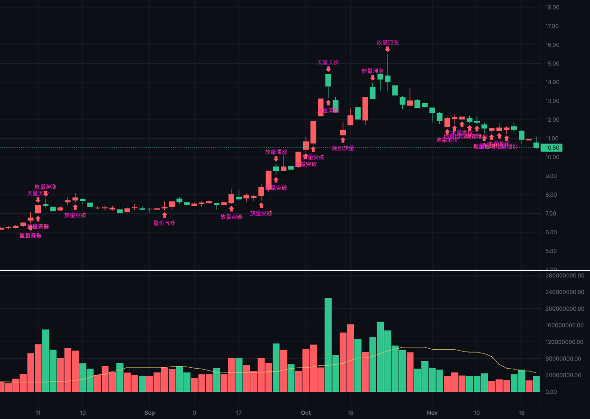
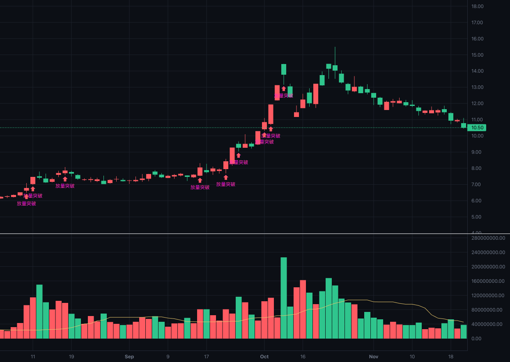
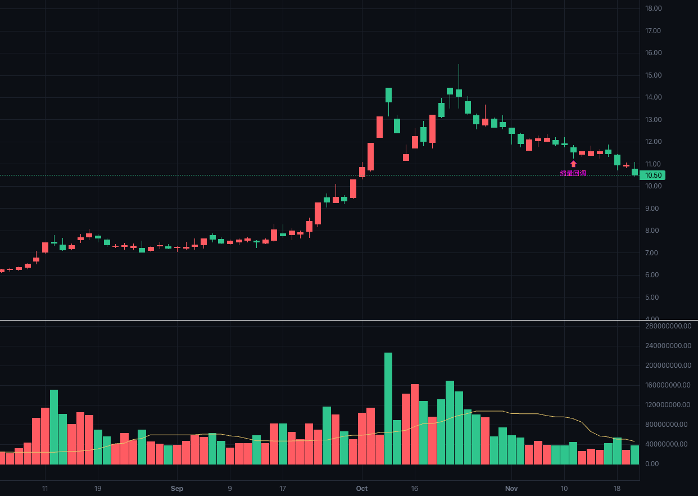
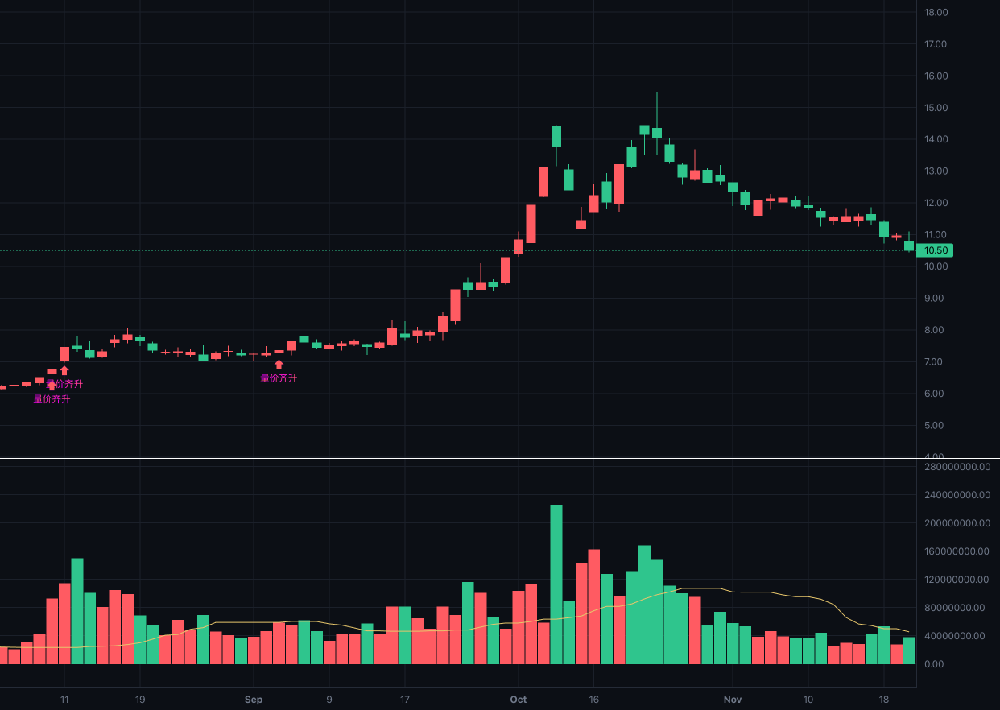
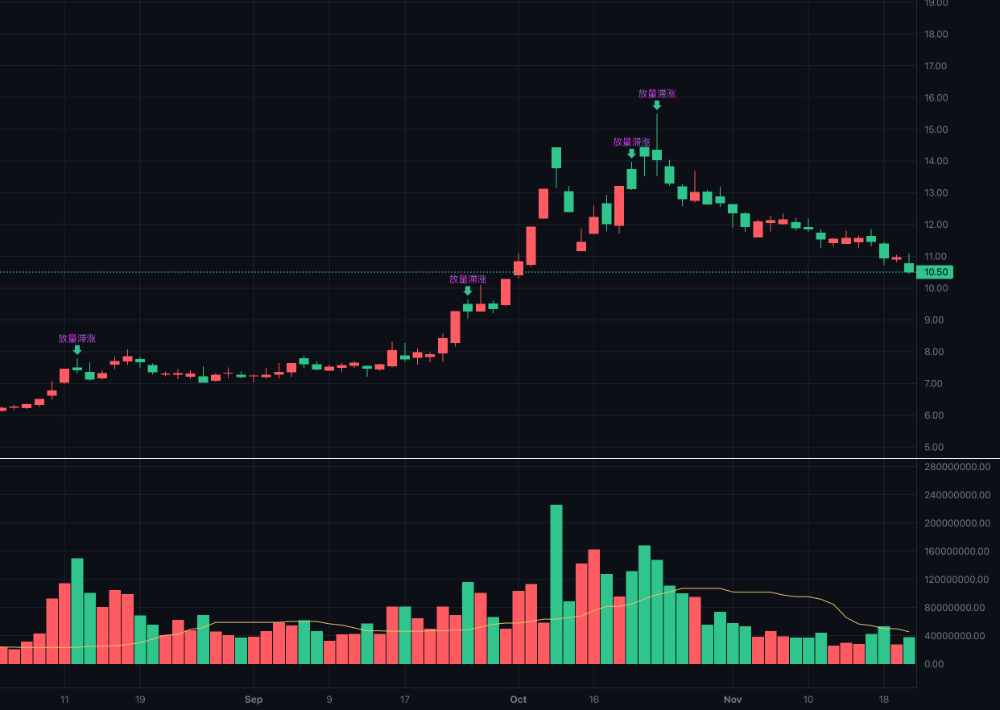
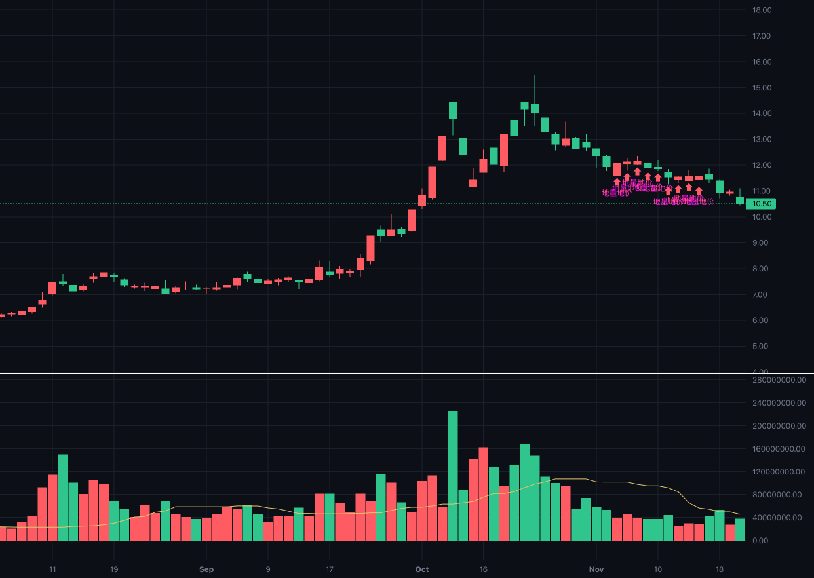
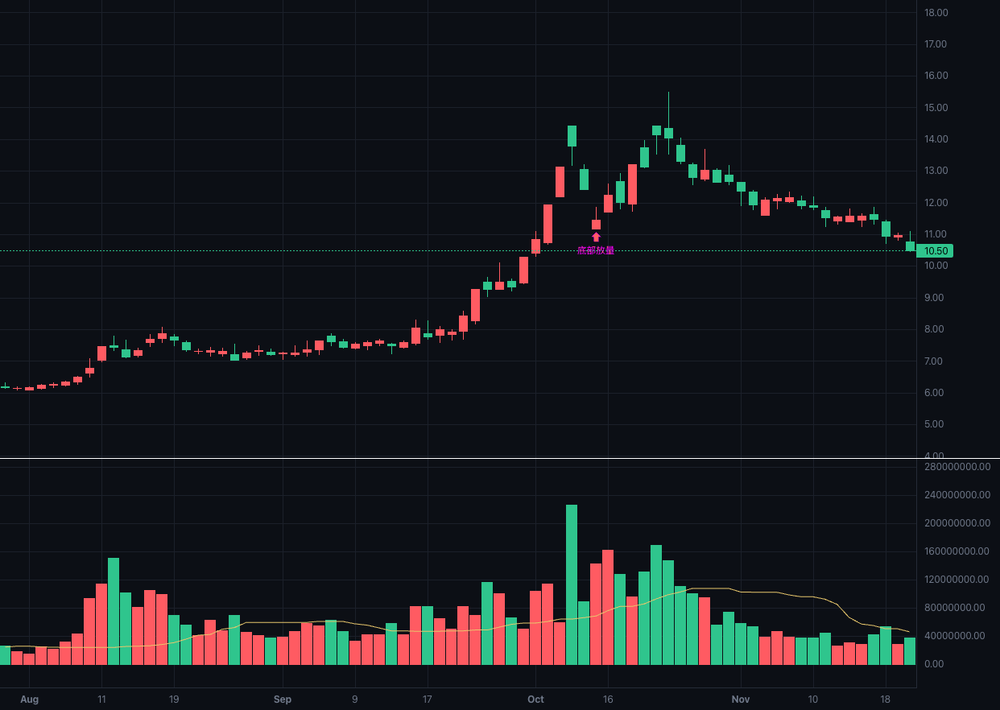

# 量价：把"放量"和"缩量"变成可执行的条件

> **一句话**：成交量指标告诉你"今天的量大不大"，量价指标告诉你"量大之后价格跟没跟"。
> 它把 7 种经典的量价关系写成 7 个可判定的条件，让"看图经验"变成能被计算、能被回测的东西。

---

## 一、什么是量价

**量价，指的是同一根 K 线上"成交量"与"价格"的关系。**

任何一张 K 线图下方都有成交量副图。它能告诉你很多事——今天是倍量还是缩量、量柱比前几天高还是矮。
但它只描述**量自己**。真正决定判断的，是量和价**放在一起看**的结果：

- 放量之后价格**突破了**前期高点 → 通常读作买盘接管；
- 放量之后价格**几乎不动** → 通常读作卖盘在借流动性出货。

这两根 K 线的量能表现可能一模一样，含义却相反。所以"量价"不是两个指标的叠加，
而是**一个关系**。

量价指标把这类关系整理成 7 个可判定的形态：

| 形态 | 一句话含义 | 方向 |
| --- | --- | --- |
| **放量突破** | 放量把价格顶过了前面一段时间的最高价 | 买入侧 |
| **缩量回调** | 连续几根价格小退，但量能持续萎缩、没有破位 | 买入侧 |
| **量价齐升** | 连续几根价格逐根抬高、量能逐根放大 | 买入侧 |
| **放量滞涨** | 量能明显放大，价格却几乎没动（且处在相对高位） | 顶部预警 |
| **天量天价** | 成交量与收盘价同时创出区间极值 | 顶部预警 |
| **地量地价** | 连续几根量能持续枯竭，价格趴在区间低位 | 买入侧 |
| **底部放量** | 已从区间高点跌掉一大截时，放量收阳 | 买入侧 |

（"方向"指它在买卖关系里偏向哪一侧，**不是**买卖建议。）

指标的组成只有两部分：

- **副图**：成交量柱（按当日阴阳着红绿）+ 一条**量能基线**折线。基线回答的是"什么算正常量"。
- **主图**：7 个形态的标记（箭头 + 中文标签），落在对应的 K 线上。



*图一：量价指标的实际渲染（深振业Ａ 000006_sz，日线，2025 年 7 月底至 11 月中）。上半部分是 K 线主图，
红箭头是买入侧形态、绿箭头是顶部预警，箭头旁的中文就是形态名；下半部分是量能副图——红绿量柱是
当日成交量，那条折线是量能基线。图中的标记比较密，因为这一段时间里形态出现得很频繁；
看盘时放大到几十根 K 线的区间就很清楚了。*

---

## 二、量价的意义及背后的市场含义

成交量代表的是**换手的强度**：在这个价位上，买卖双方成交的意愿有多强。
威科夫（Wyckoff）体系里有一句话叫"努力与结果"——成交量是"努力"，价格变动是"结果"。
量价关系，本质就是在问这两者配不配合。

| 量 | 价 | 供需解读 |
| --- | --- | --- |
| 放大 | 向上突破 | **需求接管**。有持续的买盘愿意在更高的价位接手 |
| 放大 | 不动 | **供给涌出**。大量的成交换来的却是价格原地踏步，买盘的努力被等量的卖盘吃掉了 |
| 放大 | 下跌 | **供给主导**。卖盘压倒买盘，价格被压着走 |
| 萎缩 | 小幅回落 | **卖压枯竭**。价格退一步但没人愿意大量卖出，回调是休息而不是转向 |
| 萎缩 | 向上 | **上涨缺量**。价格上去了但成交没跟上，这种上涨缺少新资金的确认 |
| 萎缩 | 停在低位 | **卖压耗尽**。跌到这个份上已经没人愿意再割了 |

一句话概括：**量是"多少人参与"，价是"他们有没有把这个价格推动"。**
参与多而价格不动，就是有人借流动性出货；参与少而价格不跌，就是没人愿意卖了。

同一句"放量"，出现在不同位置含义完全不同——这正是量价必须**连着位置一起看**的原因。
指标里的"放量滞涨"就带着高位约束（见第四节），因为下跌途中的放量横盘是承接换手，
不是顶部预警。

---

## 三、由 1、2 推出为什么会有量价指标

第一节说清了量价是什么，第二节说清了它的市场含义。那为什么还要专门做一个指标？

因为上面那些判断，长期停留在**看图经验**里。盯盘的人看一眼就知道"这是放量突破"还是"这是放量滞涨"，
但这件事有三个绕不过去的问题：

1. **没法写进策略**。"放量"是感觉还是 1.5 倍？"突破"是越过昨天的高点还是过去一个月的高点？
   没有精确定义，就无法让程序执行，也无法回测验证。
2. **没法一致地重复**。同一个人在不同情绪下，对同一张图的判断可能不同；换个人差别更大。
   把口径写死，才有可比性。
3. **没法把位置与量能一起约束**。"放量滞涨只在相对高位才有意义"这种话，
   不写成条件就永远只是提醒，而不是过滤。

所以量价指标的定位很清楚：它**不发明新的市场逻辑**，而是把第二节里那些已经被反复验证的关系，
翻译成可判定的条件。它负责回答"这根（或这几根）K 线的量价关系是哪一种"，
至于据此做什么决策，是另一个层面的事。

顺带说明它和传统量柱类指标的分工。国内讲量柱的经典体系（俗称"量学"）里有一套关于量柱长相的分类，
我们另有两个指标负责那部分：`volume`（成交量）识别高量柱、低量柱、平量柱、梯量柱、缩量柱、倍量柱；
`volume_structure`（量柱结构）识别关键量柱、将军柱、黄金柱及其黄金线。
它们看的是**量柱自己的长相**。量价指标不做重复的事——它只看"量和价配不配合"。

---

## 四、指标的计算口径，参数怎么调

### 4.1 三个窗口：先定义"跟谁比"

量价关系全是比较出来的，所以先要说清"跟什么比"。指标用了三个窗口。**注意下面的"根"
指的都是 K 线（每根 K 线带一根自己的量柱）：**

| 窗口 | 默认长度 | 取哪一段 | 拿来算什么 |
| --- | --- | --- | --- |
| **基线窗口** | 20 根 K 线 | 当根 K 线**之前**的 20 根 K 线 | 把这 20 根的**成交量**取中位数 = **量能基线** |
| **突破窗口** | 20 根 K 线 | 当根 K 线**之前**的 20 根 K 线 | 这 20 根中的最高**价** = **前高**，最低价 = **前低** |
| **位置窗口** | 60 根 K 线 | **含当根**的 60 根 K 线 | 判断"创 60 根新高/新低"与"距高点回撤多少" |

两个刻意的选择：

**"前高"只取当根之前的 20 根。** "突破"的定义是"越过之前的高点"，如果把当根也算进窗口，
当根的最高价必然是窗口最高价之一，条件就退化成恒真。

**"新高/新低"要包含当根。** "创 60 根新高"这句话本身就包含当根——当根的收盘价必须是这 60 根里最高的。

### 4.2 "正常量"是怎么算出来的，为什么这么算

这是整个指标最基础的一步：**判断放量还是缩量，必须先有"正常量"作为参照。**

做法是——取**当根 K 线之前 20 根 K 线的成交量**，把这 20 个数字从小到大排队，取**中间那个**，
得到"量能基线"。然后：

```
相对量能 = 当根 K 线的成交量 ÷ 量能基线
```

`2.0` 表示今天这根的量是近期正常水平的两倍，`0.7` 表示缩到七成。
指标里所有"放量/缩量"的判断，说的都是这个**相对量能**，而不是绝对成交量——
因为不同股票、不同周期的绝对量根本没有可比性（大盘股一天的成交额可能是一只小盘股一个月的量）。

三个设计选择，逐条说明理由：

**① 为什么用中位数，不用平均值。**
平均值会被单根异常量拉走。一个涨停板、一次指数调仓、一次大宗交易，就能让平均值明显抬高，
于是接下来几天的量在平均值面前都"不算放量"，指标直接失效。中位数只取排队后中间那个数，
单根异常量挪动不了它——这是**抗干扰**的取舍。

**② 为什么取"之前 20 根"，而不是"最近 20 根含当根"。**
如果把当根也算进基线，当根就会参与定义"正常量"，那就成了**自己跟自己比**：
一根巨量会把基线抬高，然后它自己反而显得"正常"。取当根之前，量能基线才是"在我之前市场习惯的量"，
当根与它比较才有意义。

**③ 为什么是 20 根。**
这大致是 A 股一个月（约 20 个交易日）的节奏，足够长到不被三五天的波动带偏，
又足够短到能反映近期量能水平的变化。它是个可调参数，不同品种、不同周期可以另设。

### 4.3 单根与连续多根：7 个形态分两类

这是本指标在口径上最要紧的一条分界。有些形态描述的是**一根 K 线上的事件**，
有些描述的是**一段走势**——后者不能只看单根，必须连续几根同向才算数：

| 按**单根 K 线**判定 | 按**连续 K 线**判定 |
| --- | --- |
| 放量突破、放量滞涨、天量天价、底部放量 | 缩量回调、量价齐升、地量地价 |

道理很直接：**单根的量缩或量增没有意义。** 一根量小可能是恰好没什么人交易；
"缩量回调"必须是"连续几根都在退、而且每根量都在缩"，这才是一段回调。
"地量"更是一个**状态**——量能持续枯竭一段时间，而不是某根 K 线的量创了新低。
连续多少根由参数 `consecutive_bars`（默认 3）控制。

### 4.4 七个形态的判定口径

| 形态 | 判定条件（"根"= K 线） |
| --- | --- |
| **放量突破** | 收盘价 > 前高 **且** 相对量能 ≥ 1.5 |
| **缩量回调** | 连续 3 根：每根收盘都低于前一根 **且** 每根相对量能 ≤ 0.7；**且** 最后一根收盘价 > 前低 |
| **量价齐升** | 连续 3 根：每根收盘都高于前一根 **且** 每根成交量都大于前一根 |
| **放量滞涨** | 相对量能 ≥ 1.5 **且** 当日涨跌幅绝对值 ≤ 1% **且** 距位置窗口最高价回撤 ≤ 10% |
| **天量天价** | 当根成交量 ≥ 位置窗口内的最大成交量 **且** 当根收盘 ≥ 位置窗口内的最高收盘 |
| **地量地价** | 连续 3 根：每根相对量能 ≤ 0.7 **且** 每根距位置窗口最高价回撤 ≥ 20%（都趴在低位） |
| **底部放量** | 距位置窗口最高价回撤 ≥ 20% **且** 相对量能 ≥ 1.5 **且** 当根收阳 |

两条要点：

- **"没跌破前低"是缩量回调的必要条件。** 破了位就是破位下跌，不是回调，两者含义完全相反。
- **"距高点回撤 ≤ 10%"是放量滞涨的必要条件。** 见下一节。

### 4.5 放量滞涨为什么必须带高位约束

**问：放量滞涨是不是只在上升通道才有意义？**

**是。** 这是口径里一个容易被忽略、但影响很大的点。

"放量滞涨 = 顶部预警"这个结论，前提是**价格处在相对高位**。
如果一只股票已经从高处跌了三分之一，然后在低位放量横盘，这时的"放量滞涨"读作
**承接与换手**（有人在低位接货），完全不是顶部信号。

不加约束时，下跌途中的横盘会被系统地标成卖出预警——这正是"同一句放量，位置不同含义相反"
（第二节）在实现上的体现。所以判定里加了这一条：

```
距位置窗口最高价的回撤 ≤ stagnant_max_drawdown_pct（默认 10%）
```

即只有在贴近近期高点时才认滞涨。这个参数调小＝只在真正的高位认（更严格），
调大＝下跌途中也算（趋向于失去约束）。

### 4.6 参数一览

9 个参数的默认值与取值范围（阈值类参数调大调小的后果都写在表里）：

| 参数 | 默认 | 取值范围 | 作用 / 调大的后果 |
| --- | --- | --- | --- |
| `baseline_window` 量能基线窗口 | 20 | 2–500 | 决定"正常量"用多少根 K 线算。调大基线更稳、对突发放量更敏感；调小则基线跟着近期量能走，放量不容易被认出来 |
| `breakout_window` 突破参考窗口 | 20 | 2–500 | "前高/前低"取之前多少根 K 线。调大要求突破更长期的压力（信号更少但更硬） |
| `position_window` 位置参考窗口 | 60 | 2–1000 | 判断"高低位"与"区间极值"的窗口。调大天量天价更稀有、底部要求更深的回撤 |
| `consecutive_bars` 连续K线根数 | 3 | 2–20 | 缩量回调/量价齐升/地量地价要求连续多少根同向。调大确认更长、信号更少 |
| `volume_ratio_min` 放量倍数 | 1.5 | >1 | "放量"的门槛。调大只认更猛的放量（放量突破、放量滞涨、底部放量一起变少） |
| `shrink_max` 缩量上限 | 0.7 | 0–1 开区间 | "缩量"的门槛：相对量能低于这个值才算缩量。必须小于 1 |
| `stagnant_pct` 滞涨涨幅上限 | 1.0 | 0–20 | 放量滞涨允许的当日涨跌幅绝对值。调大则放量小涨也算滞涨 |
| `stagnant_max_drawdown_pct` 滞涨高位上限 | 10 | 0–100 | 放量滞涨要求距区间高点回撤不超过它（见 4.5）。调大＝下跌途中也算 |
| `low_position_pct` 低位回撤阈值 | 20 | 0–100 开区间 | 判定"低位"的深度：距区间高点回撤超过它才算低位（地量地价、底部放量都用它） |

两个门槛必须成立：`volume_ratio_min` 必须**大于 1**，`shrink_max` 必须**小于 1**。
否则"放量"和"缩量"这两个词就没有含义了。参数填成非法值时接口会返回明确的参数错误，
而不是静默算出一个垃圾结果。

### 4.7 两条贯穿全局的实现约定

**① 样本不足时给"空"，不给 0。**
数据不够算的时候（例如只有 10 根 K 线，却要算 20 根的基线），字段返回"空值"而不是 0。
这点很关键：0 会被下游当成一个真实读数——"相对量能 = 0"读起来像极度缩量，凭空产生一个缩量信号。

**② 绝不使用未来数据。**
每一根的值只能用当根及之前的数据算。如果某根用了后面的数据，
"跑前 100 根"与"跑全部 300 根再截取前 100 根"会得到不同结果，判断就会失真。

---

## 五、7 个形态分别说明

以下 7 张图与图一取自同一段行情（深振业Ａ 000006_sz，日线，2025 年 7 月底至 11 月中）。
为了便于对照，每张图只显示**该形态**的标记。

### 5.1 放量突破

**含义**：放量把价格顶过了之前一段时间的最高价。

**口径（单根）**：收盘价 > 前高（当根之前 20 根 K 线的最高价）**且** 相对量能 ≥ 1.5。

**市场含义**：突破的有效性核心在量。越过压力位时量能明显放大，说明不是少数资金拉一下就散，
而是有持续的买盘愿意在这个更高的价位接手。缩量的突破常常是假突破——价格上去了，
但没有成交确认。



*图二：红箭头标出的就是"放量突破"出现的 K 线。对照下方副图可以看到，这些位置的量柱明显高出基线折线，
同时上方主图的收盘价越过了之前 20 根 K 线的最高价。*

### 5.2 缩量回调

**含义**：连续几根价格小步后退，但量能持续萎缩、也没有跌破前低。

**口径（连续 3 根 K 线）**：每一根收盘都低于前一根 **且** 每一根相对量能 ≤ 0.7；
**并且**最后一根的收盘价仍在"前低"（当根之前 20 根 K 线的最低价）之上。

**市场含义**：价格回落但没什么人卖——回调是"休息"而不是"转向"。这也是上升趋势里最常见的健康形态。
最后那条"不破前低"是必要的：**破位就是破位下跌，不是回调。**



*图三：这一段时间里"缩量回调"只出现过一次（箭头在右侧），说明它的口径并不宽松——
它要求连续三根都在退、而且三根量都在缩。*

### 5.3 量价齐升

**含义**：连续几根价格一级一级往上走，每一级都有新增成交跟上。

**口径（连续 3 根 K 线）**：每一根收盘都高于前一根 **且** 每一根成交量都大于前一根。

**市场含义**：价格每上一台阶都有量能配合，说明上涨是被不断入场的新资金推动的，
而不是存量资金自娱自乐。这是趋势健康度的确认。



*图四：价格连涨的同时量柱逐根变高，两者同时成立才被标记。*

### 5.4 放量滞涨

**含义**：量能明显放大，价格却几乎没动。

**口径（单根）**：相对量能 ≥ 1.5 **且** 当日涨跌幅绝对值 ≤ 1% **且** **距位置窗口最高价回撤 ≤ 10%**。

**市场含义**：大量的成交换来的却是价格原地踏步——买盘的努力被等量的卖盘吃掉了，
典型的顶部特征，对应威科夫讲的"努力与结果背离"。

**关于高位约束**：最后那条是必需的。它把"下跌途中的放量横盘"排除在外——
那种情况是承接换手，不是顶部预警。详见 4.5。



*图五：绿箭头标在 K 线**上方**（卖出侧），与买入侧箭头的方向相反。箭头所在的位置量柱明显放大，
但当日收盘几乎没有变动，而且距离区间高点很近。*

### 5.5 天量天价

**含义**：成交量和收盘价同时打到区间极值。

**口径（单根）**：当根成交量 ≥ 位置窗口（含当根 60 根 K 线）内的最大成交量 **且**
当根收盘价 ≥ 该窗口内的最高收盘价。

**市场含义**：情绪高潮。价格和量能同时打到极端，往往是最后一批买家集中入场、
早期持有者在集中派发。要注意它描述的是"极端"而非"必然反转"——极端状态可以维持，
只是这个位置的风险收益比在变差。


*图六：绿箭头处同时出现了区间内最大的量柱与最高的收盘价。*

### 5.6 地量地价

**含义**：量能持续枯竭，价格趴在区间低位。

**口径（连续 3 根 K 线）**：每一根相对量能 ≤ 0.7（持续缩量）**且** 每一根距位置窗口最高价的回撤 ≥ 20%
（持续趴在低位）。

**市场含义**：跌到这个份上，已经没人愿意再割了，成交萎缩到极端。
它是"卖压耗尽"的状态，常见于底部区域；但**不意味着立刻反转**——地量之后常常还有一段横盘。

**为什么是连续多根**："地量"是一段**状态**，不是某根 K 线的量创了新低。所以口径写成
"连续几根都缩量 + 连续几根都在低位"，出现时会在状态持续的每根 K 线上都标记。



*图七：箭头集中出现在右侧一段——那是这段行情里"量能持续枯竭 + 价格持续趴低位"的状态区间，
连续 9 个交易日满足条件，所以连续标记了 9 次。*

### 5.7 底部放量

**含义**：已经跌掉一大截之后，出现放量收阳。

**口径（单根）**：距位置窗口最高价回撤 ≥ 20% **且** 相对量能 ≥ 1.5 **且** 当根收阳
（收盘价 ≥ 开盘价）。

**市场含义**：在深度回撤的位置放量收阳，说明有资金在这个价格区间大量接手。
这可能是底部构筑的开始，也可能是下跌中继的一次反抽——它需要后续形态来确认，
不是一个"见底"结论。



*图八：箭头处价格仍处在深回撤位置，当日收阳且量柱明显高出基线。*

---

## 六、指标的局限性

写清边界比写清功能更重要，否则指标会被误用：

1. **它只描述量价关系，不判断趋势。** 除了底部放量与放量滞涨用了位置约束，
   其余形态描述的都与更大级别的趋势无关。
2. **多根形态是"状态"，不是"时点"。** 缩量回调、量价齐升、地量地价在条件持续期间
   会连续标记（图七就是这样）。看图和做条件时都要知道这一点。
3. **阈值是经验值，需要按品种标定。** 1.5 倍、0.7 倍、20% 这些默认值来自常见用法，
   不同品种、周期、流动性下合适的阈值并不相同。参数可调就是为这个留的口子。
4. **弱流动性品种上量能会失真。** 一字板、停牌复牌、指数调仓日、大宗交易，
   这些情况下成交量不能反映真实的买卖意愿，形态判断也就失去基础。
5. **七个标记全开时，满屏（几百根 K 线）会拥挤。** 看图要放大到几十根的区间，
   才能看清每个标记对应的是哪根 K 线。
6. **它不包含仓位与风控。** 指标只回答"这几根 K 线的量价关系属于哪一种"，
   不回答"该买多少""错了在哪里止损"。

---

## 风险提示

本文仅用于说明一个技术指标的计算口径与市场解释，**不构成任何投资建议**。
文中所有形态描述都是对历史量价关系的统计性刻画，历史规律不代表未来表现，
也不保证指标在实盘中有效。市场有风险，任何决策及其后果由投资者自行承担。
